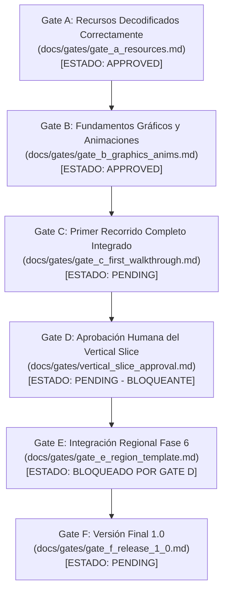
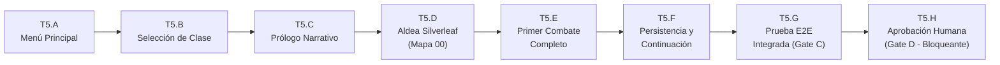

# Plan Maestro de Desarrollo: Heroes Lore: Zero para PC (Godot 4)

Documento canónico de arquitectura, metodología y planificación técnica incremental.  
**Plataforma objetivo:** PC (Windows) · **Motor:** Godot 4.7.2 Standard (GDScript) · **Perspectiva:** 2D cenital ligeramente elevada (~30º) · **Estilo visual:** 2D ilustrado y remasterizado 4x pixel-perfect fiel al original de 2008, con composición inspirada en Bleaklight Falls · **Alcance:** 100% de la historia y contenido original confirmado en la versión completa.

---

## 1. Filosofía Oficial de Desarrollo

Este proyecto sigue cinco principios rectores irrenunciables para garantizar calidad, fidelidad y avance sostenible:

### Principio A: Base técnica suficiente sin sistemas aislados innecesarios
Primero se estabilizan los fundamentos indispensables para el primer recorrido jugable (extracción, mapas, animaciones, movimiento, colisiones, diálogos, eventos, combate, UI básica y guardado). No se construyen sistemas masivos o abstractos por adelantado. La infraestructura mínima se integra en un flujo real y se amplía únicamente conforme la historia lo demande.

### Principio B: Construir el primer recorrido jugable de principio a fin (Fase 5)
Antes de emprender la producción masiva de mapas, enemigos y personajes, se debe completar un primer recorrido integrado que inicie desde el arranque del ejecutable (`scenes/Main.tscn`) hasta el primer combate completo y el guardado persistente. El jugador no debe necesitar comandos de consola, teletransportes, scripts de depuración ni escenas sandbox para recorrerlo.

### Principio C: Completar el juego siguiendo el orden de la historia original (Fase 6)
Una vez aprobado formalmente el primer recorrido por el usuario (Gate D), el desarrollo del resto de la aventura se ejecuta estrictamente de forma cronológica, región por región y según la progresión del juego original. Cada región debe quedar jugable, integrada con el progreso acumulado y verificada antes de iniciar la siguiente.

### Principio D: Preservar la fidelidad al original
Mapas, misiones, textos, diálogos, personajes, fórmulas de combate, curvas de experiencia, comportamientos de IA y secretos se extraen y verifican a partir del archivo JAR original (`Heroes Lore Zero 360x640 Spanish.jar`), el código decompilado y el emulador J2ME. No se inventa contenido para llenar vacíos. Cualquier incertidumbre técnica se registra en `docs/OPEN_QUESTIONS.md` separando hechos comprobados de hipótesis.

### Principio E: Cada cambio verificable, reversible y comiteado de inmediato
Cada tarea cuenta con identificador único, dependencias explícitas, archivos afectados, prueba reproducible y criterio de aceptación objetivo. Todo cambio se comitea atómicamente de manera inmediata. Ninguna prueba se declara aprobada sin haber sido medida efectivamente.

---

## 2. Decisiones Técnicas Consolidadas del Proyecto

| Parámetro | Decisión Canónica | Justificación / Evidencia |
|---|---|---|
| **Juego** | Port fan-made de *Heroes Lore: Zero* (J2ME, 2008). | Preservación de la obra en PC moderno con mejoras de calidad de vida. |
| **Motor** | Godot Engine 4.7.2 Standard (versión estable local fijada). | `Godot_v4.7.2-stable_win64.exe`. Compatibilidad comprobada en modo headless y gráfico (DEC-001). |
| **Lenguaje** | GDScript para runtime del juego; Python 3.11 para herramientas de extracción y validación. | Rendimiento óptimo en Godot 4 y versatilidad de procesamiento binario en herramientas. |
| **Continuidad del Motor** | No migrar a libGDX ni otros frameworks. | Mantener inversión técnica realizada en Godot 4 y GDScript (DEC-005). |
| **Plataforma Inicial** | Windows 10 / 11 de 64 bits. | Ejecutable independiente con dependencias autocontenidas. |
| **Perspectiva y Dimensión** | 2D con vista cenital ligeramente elevada (~30º). | Variante B aprobada: Zoom 2.0x, offset vertical `(0, -80 px)`, sin construcción 3D (DEC-004, `docs/spec/camera.md`). |
| **Referencia Visual** | Inspiración en *Bleaklight Falls* para composición, capas y lectura de terreno. | No se copian assets ni recursos propietarios; se preserva la identidad original de HLZ. |
| **Dirección Artística** | 2D ilustrado y remasterizado 4x pixel-perfect. | Extracción fiel de capas originales del JAR con reescalado entero 4x (DEC-006). |
| **Representación de Lucian** | Clase 1 Asesino (`hero/h1`), doble daga `hero/w/400`, chaleco `hero/1/l00`, pantalón morado `hero/2/l00`. | 134/134 sprites auditados con paridad criptográfica 100% contra bytecode J2ME (DEC-007). |
| **Mapeo de Marcha** | 4 fotogramas base J2ME repetidos consecutivamente (`i % 4`) para formar 8 archivos a 10 FPS. | Fluidez sin deformaciones ni saltos; cero caídas a reposo durante el movimiento (DEC-008). |
| **Controles** | Mando/Gamepad como opción principal (stick con zona muerta 0.20, D-pad, botones); teclado WASD como alternativa. | `InputManager` centralizado (`godot/scripts/input_manager.gd`). |
| **Rendimiento** | 60 FPS estables en equipo modesto (Intel UHD); soporte hasta 4K en hardware dedicado. | Renderizador Compatibility (OpenGL 3.3 / ANGLE), perfiles Bajo, Medio y Alto medidos (DEC-002, DEC-003). |
| **Calidad de Vida (QoL)** | Guardado libre en 3 ranuras, baúl común transferible, minimapa y marcadores de misión. | Especificado en `docs/spec/events_quests.md` y `docs/reference/`. |
| **Distribución y Git** | Uso personal. JAR original, assets crudos y datos extraídos locales excluidos por `.gitignore`. | `.gitignore` activo; preservación estricta de archivos locales. |

---

## 3. Puertas de Aprobación Explícitas (Gates)

El proyecto implementa 6 puertas de calidad formales. Cada puerta exige criterios cuantitativos, evidencias registradas y un documento formal en `docs/gates/`:

1. **Gate A — Recursos decodificados correctamente:** (`docs/gates/gate_a_resources.md` · **APPROVED**).
2. **Gate B — Fundamentos gráficos y animaciones:** (`docs/gates/gate_b_graphics_anims.md` · **APPROVED**).
3. **Gate C — Primer recorrido completo integrado:** (`docs/gates/gate_c_first_walkthrough.md` · **PENDING**).
4. **Gate D — Aprobación humana del Vertical Slice:** (`docs/gates/vertical_slice_approval.md` · **PENDING · BLOQUEANTE**).
   - Bloquea absolutamente el inicio de la producción masiva de la Fase 6.
   - Requiere la prueba jugable directa y la firma explícita del usuario (`APPROVED`).
5. **Gate E — Cada región integrada:** (`docs/gates/gate_e_region_template.md` · **BLOQUEADO POR GATE D**).
   - Aplicable a cada una de las 5 regiones de la Fase 6 antes de permitir el paso a la siguiente.
6. **Gate F — Versión final y empaquetado:** (`docs/gates/gate_f_release_1_0.md` · **PENDING**).

---

## 4. Fases y Tareas de Desarrollo

### FASE 0 — Entorno Reproducible y Control del Proyecto
**Objetivo:** Establecer un entorno de ingeniería estable, verificable y con dependencias fijadas.  
**Criterio de salida:** Herramientas responden a comandos de versión, proyecto Godot ejecuta en headless y gráfico con código de salida 0, `.gitignore` protege recursos privados.  
**Estado:** **COMPLETA (100%)**

- **T0.1** Instalación y verificación de herramientas (Git, Python 3.11, JDK 17, Godot 4.7.2, FFmpeg, FluidSynth, Vineflower, Krita).
- **T0.2** Estructura del repositorio, configuración de `.gitignore` y documentos base.
- **T0.3** Registro de integridad SHA-256 del JAR original (`F4F280AE...` en `docs/spec/content_scope.md`).
- **T0.4** Inicialización del proyecto Godot 4.7.2 con renderizador Compatibility y resolución 1920×1080.
- **T0.5** Validación técnica del pipeline de importación 2D y canal alfa (`godot/scenes/TestPipeline.tscn`).
- **T0.6** Guía visual base `art/STYLE.md` y catálogo `art/manifest.csv`.
- **T0.7** Documentos de arquitectura: `DECISIONS.md`, `OPEN_QUESTIONS.md`, `spec/performance.md`, `spec/content_scope.md`.
- **T0.8** Registro de especificaciones de hardware del equipo de desarrollo.
- **T0.9** Escena de benchmark 2D sintética (`godot/scenes/Benchmark2D.tscn`) con perfiles de rendimiento.

---

### FASE 1 — Referencia Completa del Juego Original
**Objetivo:** Construir una base documental y audiovisual verificable del juego J2ME original ejecutado en emulador.  
**Criterio de salida:** Inventario completo de contenido en `docs/coverage.csv`, tasa de ticks medida (`TICK_HZ = 14 Hz`), 6 clases identificadas y referencias de mapas disponibles.  
**Estado:** **PARCIAL / EN PROGRESO** (Fundamentos cubiertos; grabación continua regional en curso).

- **T1.1** [HECHO] Ejecución de `Heroes Lore Zero 360x640 Spanish.jar` en FreeJ2ME-Plus con soporte de mando.
- **T1.2** [EN CURSO] Registro audiovisual de referencia: capturas y videos de clases, guardado y mapas en `docs/reference/`.
- **T1.3** [HECHO] Matriz de cobertura inicial en `docs/coverage.csv` (151 entidades catalogadas con jerarquía regional).
- **T1.4** [HECHO] Medición de la frecuencia del bucle de lógica original: `TICK_HZ = 14 Hz` (~71.4 ms/tick).

---

### FASE 2 — Ingeniería Inversa y Reconstrucción de Recursos (Gate A)
**Objetivo:** Decompilar, decodificar y validar la totalidad de los datos y recursos binarios del JAR original.  
**Criterio de salida:** 100% de los archivos del JAR extraídos sin excepciones, mapas exportados a JSON, sprites reconstruidos en PNG con canal alfa y auditados fuera del motor.  
**Estado:** **COMPLETA (100% - Gate A Aprobado)**

- **T2.1** [HECHO] Inventario completo del JAR: 1,112 archivos clasificados en `docs/inventory.csv`.
- **T2.2** [HECHO] Decompilación de las 144 clases Java con Vineflower a `reverse/decompiled/`.
- **T2.3** [HECHO] Mapeo de clases ofuscadas en `reverse/mapping.txt` (bucle, gráficos, sonido, mapas, combate).
- **T2.4** [HECHO] Especificación formal de formatos binarios en `docs/formats/` (`mpm.md`, `map_m.md`, `tdf.md`, `mmi.md`).
- **T2.5** [HECHO] Implementación de parsers modulares en `tools/parsers/` para cada formato binario.
- **T2.6** [HECHO] Extractor automatizado `tools/extract.py`: exporta 141 mapas JSON, 751 cadenas de texto, 3,199 sprites PNG, 17 MIDI y 14 WAV.
- **T2.7** [HECHO] Suite de verificación y hojas de contacto (`tools/verify_fase2.py`, `render_maps.py`, `make_contact_sheets.py`).
- **T2.8** [HECHO] Catálogo de diseño de entidades y diferenciación de hechos observados vs interpretaciones (`art/refs/catalog.md`).

---

### FASE 3 — Especificación Inversa de la Lógica de Juego
**Objetivo:** Documentar matemáticamente y formalizar todas las reglas, fórmulas y sistemas originales antes de su implementación general.  
**Criterio de salida:** Documentación exhaustiva en `docs/spec/*.md` con pseudocódigo, tablas numéricas y tests de paridad independientes.  
**Estado:** **COMPLETA (100%)**

- **T3.1** [HECHO] Motor y bucle de simulación: desacoplamiento de reloj a 14 Hz con interpolación visual en `docs/spec/engine.md`.
- **T3.2** [HECHO] Sistema de movimiento, velocidades (3 px/tick = 42 px/s), colisiones bitwise de casillas en `docs/spec/movement.md`.
- **T3.3** [HECHO] Fórmulas de combate: daño físico, mitigación por defensa, tirada de crítico (`dg.java:2165`), evasión y robo de vida en `docs/spec/combat.md`.
- **T3.4** [HECHO] Curva exponencial de experiencia, escalado de stats de las 6 clases e inventario en `docs/spec/progression.md`.
- **T3.5** [HECHO] Máquina de estados de IA (6 fases), radios de aggro y patrones de 11 jefes en `docs/spec/ai_enemies.md`.
- **T3.6** [HECHO] Sistema de eventos, bitset de flags de historia (`dq.java`), triggers de mapas y guardado en `docs/spec/events_quests.md`.
- **T3.7** [HECHO] Suite de pruebas automatizadas de paridad numérica (`tests/test_combat_parity.py` - 7/7 tests aprobados).

---

### FASE 4 — Fundamentos Técnicos Integrados (Gate B)
**Objetivo:** Construir los sistemas de infraestructura técnica mínima requeridos por el juego en Godot 4.  
**Criterio de salida:** Autoloads operativos, cámara aprobada, controles universales, suite de animación verificada con paridad criptográfica 100%.  
**Estado:** **COMPLETA (100% - Gate B Aprobado)**

- **T4.1 & T4.2** [HECHO] Gestor de pantalla y ventana `DisplayManager` (`godot/scripts/display_manager.gd`) con soporte de 720p a 4K.
- **T4.3** [HECHO] Reloj de lógica dual desacoplada `GameClock` (`godot/scripts/game_clock.gd`) a 14 Hz exactos con factor alfa.
- **T4.4** [HECHO] Cargador de datos `DataLoader` (`godot/scripts/data_loader.gd`) que consume mapas y textos desde `out/`.
- **T4.5 & T4.6** [HECHO] Prototipo de encuadre y cámara 2D (`godot/scenes/CameraComparison.tscn`).
- **T4.7** [HECHO] Aprobación explícita de la Variante B (Cenital amplia, zoom 2.0x, offset -80 px) en `docs/spec/camera.md`.
- **T4.8** [HECHO] Mapeo de acciones abstractas en `InputManager` (`godot/scripts/input_manager.gd`) con mando y teclado.
- **T4.9** [HECHO] Suite de perfiles gráficos y medición de rendimiento `ProfileManager` (`godot/scripts/profile_manager.gd`).
- **T4.10** [HECHO] Auditoría exhaustiva de Lucian Asesino (`hero/h1`), composición de 8 capas canónicas y resolución de defectos (`KNOWN_GRAPHICS_ISSUES.md`).
- **T4.11** [HECHO] Suite de validación en vivo de animaciones en Godot (`godot/scripts/anim_review.gd`): 1,552 aserciones (1,548 PASS, 0 FAIL, 4 NOT TESTED). Gate B aprobado.

---

### FASE 5 — Primer Recorrido Completo y Puerta de Aprobación (Gates C y D)
**Objetivo:** Construir el hito de integración más crucial: el primer recorrido jugable continuo e ininterrumpido desde el inicio del juego hasta el guardado y continuación.  
**Dependencias:** Fases 0 a 4 completas.  
**Criterio de salida:** Recorrido E2E superado sin errores, suite de integración limpia (Gate C) y firma formal del usuario en `docs/gates/vertical_slice_approval.md` (Gate D).  
**Estado:** **EN CURSO (Próxima fase activa de desarrollo)**

#### T5.A — Menú Principal y Navegación
- **Objetivo:** Crear la escena de arranque principal con opciones de Nueva Partida, Continuar (habilitada solo si existe partida válida), Opciones y Salir.
- **Archivos:** `godot/scenes/MainMenu.tscn`, `godot/scripts/main_menu.gd`.
- **Pruebas:** Navegación fluida con stick/D-pad de mando y flechas/Enter de teclado, foco visual claro en botones, salida limpia.
- **Criterio de aceptación:** Flujo de arranque estándar sin errores de consola; selección de "Nueva Partida" transiciona limpiamente a T5.B.

#### T5.B — Selección de Personaje y Persistencia de Clase
- **Objetivo:** Implementar la pantalla canónica de selección de clase original (Asesino, Guerrero, Caballero, Pistolero), mostrando retrato, atributos base y descripción.
- **Archivos:** `godot/scenes/CharacterSelect.tscn`, `godot/scripts/character_select.gd`.
- **Pruebas:** La clase elegida inicializa los atributos, habilidades y sprites correctos en el nodo `Player` y en los metadatos de sesión.
- **Criterio de aceptación:** Al elegir Asesino (o cualquier clase inicial confirmada), el juego inicia con el equipamiento y stats documentados en `docs/spec/progression.md`.

#### T5.C — Prólogo y Secuencia Narrativa Inicial
- **Objetivo:** Reconstruir la secuencia de introducción, diálogos y eventos narrativos que dan inicio a la aventura según el orden original del JAR (`m/m/00` y `t/m/0.tdf`).
- **Archivos:** `godot/scenes/Prologue.tscn`, `godot/scripts/dialog_box.gd`, `godot/scripts/event_manager.gd`.
- **Pruebas:** Reproducción automática de cinemática/diálogo con avance mediante botón de interacción (`[A]` / `[Espacio]`).
- **Criterio de aceptación:** El jugador completa el prólogo y toma el control activo en Aldea Silverleaf sin necesidad de comandos especiales.

#### T5.D — Inicio de la Aventura y Exploración de Aldea Silverleaf
- **Objetivo:** Conectar al jugador en el mapa genuino 4x de Aldea Silverleaf (`m_00`), permitiendo movimiento, colisión con edificios/árboles, e interacción con al menos un NPC de la aldea.
- **Archivos:** `godot/scenes/World.tscn`, `godot/scripts/world.gd`, `godot/art_samples/map_silverleaf.png`.
- **Pruebas:** Desplazamiento en las 4 direcciones a 42 px/s, cámara Variante B centrada con anticipación, colisión con el entorno sin atravesar muros, apertura de diálogo con NPC.
- **Criterio de aceptación:** El jugador puede explorar la aldea con mando y teclado y salir por el sendero exterior hacia la zona de combate.

#### T5.E — Primer Combate Completo y Recompensa
- **Objetivo:** Implementar el primer encuentro hostil canónico en la salida de Silverleaf (Lobo del bosque o guardia hostil).
- **Archivos:** `godot/scenes/EnemyWolf.tscn`, `godot/scripts/enemy_wolf.gd`, `godot/scripts/player.gd`.
- **Pruebas:** Ciclo de IA (detección, persecución, ataque), recepción de daño mutuo, ejecución de Combo 1 / Combo 2 de Lucian con tajos VFX dorados, muerte del enemigo y entrega de EXP (+10) y botín.
- **Criterio de aceptación:** Combate resuelto según las fórmulas matemáticas de `docs/spec/combat.md`, con animación de muerte y HUD actualizado.

#### T5.F — Persistencia y Continuación de Partida
- **Objetivo:** Integrar el punto de guardado (menú de pausa o altar/estatua de guardado), escribir el estado a `user://saves/save_slot_1.json`, salir al Menú Principal y continuar la partida.
- **Archivos:** `godot/scripts/save_manager.gd`, `godot/scenes/MainMenu.tscn`.
- **Pruebas:** Guardar tras el combate, salir al menú, verificar que la opción "Continuar" está activa, cargar y comprobar que el jugador reaparece con el nivel, HP, EXP y posición correctos.
- **Criterio de aceptación:** Paridad exacta de datos serializados y deserializados sin desincronización de escena.

#### T5.G — Prueba de Integración Extremo a Extremo (E2E - Gate C)
- **Objetivo:** Automatizar y ejecutar el recorrido continuo completo: *Main.tscn -> Menú -> Selección de Personaje -> Prólogo -> Silverleaf -> NPC -> Combate -> Victoria -> Guardar -> Salir -> Continuar*.
- **Archivos:** `tests/test_walkthrough_e2e.py` o suite de automatización en Godot.
- **Pruebas:** Ejecución en modo headless y gráfico registrando telemetría y capturas de cada hito.
- **Criterio de aceptación:** Cero errores de script, cero excepciones de render y todas las transiciones validadas. Gate C pasa a `APPROVED`.

#### T5.H — Demostración Jugable y Aprobación de la Persona Responsable (Gate D)
- **Objetivo:** Entrega del Vertical Slice completo a la persona responsable del proyecto para su evaluación jugable, visual y de rendimiento.
- **Archivos:** `docs/gates/vertical_slice_approval.md`.
- **Revisión humana requerida:** Sensación a los mandos, arte 2D, animación, fluidez a 60 FPS, coherencia narrativa y guardado.
- **Criterio de aceptación:** Registro explícito de `APPROVED` firmado por el usuario en `vertical_slice_approval.md`.

---

### FASE 6 — Producción de la Historia, Región por Región (Gate E)
**Objetivo:** Desarrollar todo el contenido restante del juego en estricto orden cronológico por regiones, asegurando que cada zona quede 100% jugable e integrada antes de avanzar.  
**Dependencia bloqueante:** **Gate D estrictamente aprobado por el usuario.**  
**Criterio de salida:** Las 5 regiones completadas, 141 mapas integrados, todas las misiones y jefes funcionales, `docs/coverage.csv` al 100% verificado.

#### Orden Cronológico de Producción Regional:
1. **Región 1 — Aldea Silverleaf y Territorios Cercanos:** Mapas `m_00`, `m_07` (Orfanato), `m2_d5`, `m2_d6`.
2. **Región 2 — Ciudad Humming, Aldea Melon y Puertos:** Mapas `m_03`, `m_04`, `m_05`, mazmorras adyacentes.
3. **Región 3 — Ciudad Ciruelo, Chelen y Zonas de Caza:** Mapas `m_01`, `m_02`, `m_06`, rutas exteriores.
4. **Región 4 — Fortaleza del Sur, Templo y Subsuelo:** Mapas `m2_a0`–`m2_b0`, `m2_b1`–`m2_b9`, `m2_e0`.
5. **Región 5 — Arenas de Jefes Finales, Tumba y Clímax:** Mapas `m2_c1`–`m2_d4`, `m2_d7`, `m2_d9`.

#### Metodología de 12 Pasos por Región (Gate E):
Cada región debe ejecutar secuencialmente y documentar en su respectivo Gate E:
1. Reconstrucción de mapas y conexiones de portales.
2. Tilesets en 4x con colisiones bitwise verificadas.
3. Colocación de personajes y NPCs canónicos.
4. Diálogos y eventos enlazados desde `.tdf`.
5. Misiones activas y banderas de progresión (`mmi/` y `dq.java`).
6. Monstruos y variantes con IA de combate.
7. Tiendas, forjas, cofres y economía local.
8. Encuentros especiales y jefes de zona.
9. Minijuegos o mecánicas secundarias asociadas.
10. Integración con el progreso del jugador desde regiones anteriores.
11. Pruebas automáticas de carga y navegación sin errores (`tools/verify_region.py`).
12. Validación y aprobación humana de la región (Gate E).

---

### FASE 7 — Interfaz, Audio y Calidad de Vida Completa
**Objetivo:** Integrar el audio definitivo remasterizado, la interfaz de usuario completa y las mejoras de calidad de vida aprobadas.  
**Criterio de salida:** Audio MIDI/WAV limpio con mezcla por buses, minimapa con niebla, marcadores de objetivo funcionales y guardado en todas las ranuras.

- **T7.1** Renderizado de las 17 pistas MIDI con FluidSynth a formato OGG con detección de loop, conservando selector para MIDI original.
- **T7.2** Remuestreo, normalización y limpieza de los 14 efectos de sonido WAV (48 kHz) con selector de audio clásico.
- **T7.3** Mezcla por buses de audio (Música, SFX, Interfaz) con controles de volumen independientes en Opciones.
- **T7.4** HUD definitivo, árbol de habilidades de clase y menús 2D con navegación por foco para mando y teclado.
- **T7.5** Minimapa en tiempo real derivado de los datos de mapa con niebla de exploración y visualización a pantalla completa.
- **T7.6** Marcadores visuales de misión en brújula y mapa derivados de los 2,911 puntos de `out/mmi/`.
- **T7.7** Almacenamiento público compartido (baúl común) para transferir oro y objetos entre las 3 ranuras de guardado.

---

### FASE 8 — QA Integral, Fidelidad y Regresión
**Objetivo:** Batería exhaustiva de pruebas de control de calidad sobre el juego completo para garantizar cero bloqueos y paridad total.  
**Criterio de salida:** Cero defectos bloqueantes, matriz de cobertura al 100% con evidencias, resultados claramente divididos en `PASS`, `FAIL` y `NOT TESTED`.

- **T8.1** Pruebas automatizadas de fórmulas de combate y progresión en todas las clases y niveles hasta 99.
- **T8.2** Prueba de humo global: recorrido headless de los 141 mapas verificando carga, tiles y colisiones sin excepciones.
- **T8.3** Auditoría visual y dimensional de las plantas de todos los mapas contra las capturas del emulador original.
- **T8.4** Verificación de rutas críticas narrativas y mitigación de bloqueos de progresión con guardados forzados.
- **T8.5** Pruebas de rendimiento en escenas densas en perfiles Bajo, Medio y Alto en 1080p y 4K.
- **T8.6** Partida completa jugada con mando por la persona responsable, con registro y resolución de errores en `docs/bugs.md`.
- **T8.7** Auditoría final de coherencia de sprites y animaciones (sin parpadeos, desalineación de armas ni fallos de pivote).

---

### FASE 9 — Empaquetado y Versión Completa (Gate F)
**Objetivo:** Preparar la versión final 1.0 lista para su distribución y uso personal en PC.  
**Criterio de salida:** Instalación limpia, ejecución desde cero hasta los créditos y New Game+ verificado.

- **T9.1** Menú de opciones completo: resolución, modo de pantalla, audio, controles, remapeo y asignación de mando.
- **T9.2** Exportación del proyecto para Windows con las plantillas oficiales de Godot 4.7.2.
- **T9.3** Script de instalación limpia `setup.bat` que valida el entorno y recursos.
- **T9.4** Documentación de usuario, controles y manual de resolución de incidencias en `README.md`.
- **T9.5** Etiquetado de versión `v1.0`, archivo de copias de seguridad locales y ratificación en `docs/gates/gate_f_release_1_0.md`.

---

## 5. Instrucciones Obligatorias para el Agente de IA

Al iniciar cualquier sesión o tarea en este repositorio:

1. **Lectura Previa Obligatoria:** Leer siempre `docs/PLAN.md`, `docs/PROGRESS.md`, `docs/OPEN_QUESTIONS.md` y `docs/DECISIONS.md`.
2. **Enfoque Atómico:** Trabajar estrictamente en **una única tarea a la vez**. No iniciar múltiples tareas en paralelo ni saltar a fases posteriores.
3. **Respeto Absoluto a los Gates:**
   - La Fase 5 no puede finalizar sin Gate C y Gate D.
   - La Fase 6 (producción masiva) está **ESTRICTAMENTE BLOQUEADA** hasta que `docs/gates/vertical_slice_approval.md` registre `APPROVED` firmado por el usuario.
   - El agente **NUNCA** puede auto-aprobar Gate D.
4. **Política Estricta de Git:** Cada cambio realizado debe comitearse de manera inmediata con un mensaje convencional descriptivo (`feat:`, `fix:`, `docs:`, `test:`).
5. **Pruebas Reproducibles:** Toda modificación de código debe verificarse mediante ejecución antes de dar la tarea por finalizada.
6. **Honestidad en Resultados:** Distinguir con rigor `PASS`, `FAIL` y `NOT TESTED`. No emitir declaraciones incondicionales de éxito ni ocultar limitaciones conocidas.
7. **Detención ante Incertidumbres o Decisiones de Alto Impacto:** Si una decisión afecta la fidelidad del juego o requiere juicio estético, documentar la pregunta en `docs/OPEN_QUESTIONS.md` y detenerse para consulta humana.
