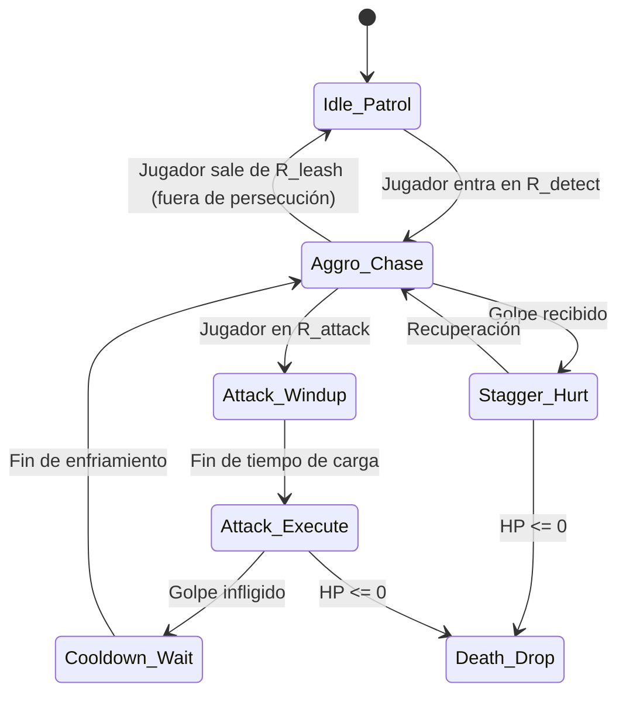

# Especificación de IA de Enemigos y Jefes (T3.5)

**Documento:** `docs/spec/ai_enemies.md`  
**Clases desofuscadas fuente:** `ec.java`, `en/edf`, `en/cif`, `e.java`, `m/m2/c1` a `c9`  
**Estado:** Confirmado por ingeniería inversa  

---

## 1. Máquina de Estados de IA de Enemigos Estándar

Los enemigos regulares procesan su comportamiento mediante una máquina de estados de 6 fases:

### Definición de Parámetros de Distancia y Tiempos

| Parámetro | Símbolo | Valor típico en tiles (px) | Comportamiento |
|---|---|---|---|
| **Radio de Detección** | $R_{\text{detect}}$ | 4 a 6 tiles (64 a 96 px) | Distancia euclídea para pasar de patrulla a persecución activa. |
| **Radio de Abandono (Leash)** | $R_{\text{leash}}$ | 9 a 12 tiles (144 a 192 px) | Si el héroe se aleja más allá de esta distancia, el enemigo desiste y vuelve a su origen. |
| **Rango de Ataque Melee** | $R_{\text{atk\_melee}}$ | 1 tile (16 a 24 px) | Distancia de contacto para iniciar golpe cuerpo a cuerpo. |
| **Rango de Ataque Ranged** | $R_{\text{atk\_dist}}$ | 5 a 7 tiles (80 a 112 px) | Utilizado por arqueros, murciélagos lanzadores y torretas. |
| **Enfriamiento de Ataque** | $T_{\text{cooldown}}$ | 14 a 28 ticks (~1.0s a 2.0s) | Pausa entre combos para permitir contraataques del jugador. |
| **Tiempo de Aturdimiento** | $T_{\text{stagger}}$ | 3 a 5 ticks (~200 a 350 ms) | Congelación breve del enemigo al recibir un impacto contundente. |

---

## 2. Lógica de Persecución y Navegación

En cada tick de lógica (14 Hz), un enemigo en estado `Aggro_Chase` calcula la diferencia de posición respecto a Lucian $(\Delta X = X_{\text{player}} - X_{\text{enemy}}, \; \Delta Y = Y_{\text{player}} - Y_{\text{enemy}})$:

1. **Selección del Eje Primario:**
   - Si $|\Delta X| > |\Delta Y|$, intenta avanzar horizontalmente hacia la izquierda o derecha.
   - En caso contrario, intenta avanzar verticalmente hacia arriba o abajo.
2. **Evasión de Obstáculos Simples:**
   - Si la celda objetivo tiene colisión sólida (`is_collision == true`), el enemigo conmuta inmediatamente al eje secundario para bordear el muro en lugar de quedar atascado.

---

## 3. Patrones de Combate de Jefes Principales

Los 11 encuentros contra jefes de *Heroes Lore: Zero* incorporan mecánicas multi-fase:

### 3.1 Anthony (`m/m2/c1.m`, `c7.m`, `d0.m`)
- **Arquetipo:** Espadachín pesado de élite.
- **Fase 1 (100% - 50% HP):** Tajo frontal de 3 tiempos, embestida en línea recta de 3 tiles.
- **Fase 2 (< 50% HP):** Aura roja de furia. Velocidad incrementada en $+25\%$. Genera ondas cortantes a distancia al finalizar el combo de 3 tajos.

### 3.2 Alicia (`m/m2/c2.m`, `c7.m`, `d0.m`)
- **Arquetipo:** Hechicera elemental ágil.
- **Fase 1:** Proyectiles mágicos teledirigidos, teletransporte a esquinas de la arena cuando el héroe se acerca a menos de 2 tiles.
- **Fase 2:** Invocación de pilares de fuego en cuadrícula fija en el suelo (telegraph visible de 1s antes de la erupción de daño).

### 3.3 Aquila (`m/m2/c3.m`, `c8.m`)
- **Arquetipo:** Asesino sombrío veloz.
- **Mecánica especial:** Desaparición en sigilo durante 2 segundos con reaparición por la espalda de Lucian con puñalada crítica. Requiere giro rápido y bloqueo defensivo con escudo.

### 3.4 Quimera (`m/m2/c4.m`, `d2.m`) y Perro del Infierno (`m/m2/c6.m`, `d3.m`)
- **Arquetipo:** Bestias gigantes de fuego.
- **Mecánicas:**
  - Aliento de fuego en cono frontal ($45^\circ$, 3 tiles de alcance).
  - Pisotón que aturde en área circular pequeña ($R = 32 \text{ px}$).
  - Embestida rápida con hitbox prolongada.

### 3.5 Timoros (`m/m2/c5.m`) y Dios Gigante (`m/m2/c9.m`)
- **Arquetipo:** Colosos blindados.
- **Mecánicas:**
  - Invulnerabilidad frontal absoluta (su armadura bloquea todo daño frontal).
  - El jugador debe flanquear o rodear al jefe durante sus animaciones lentas de recuperación para golpear su espalda desprotegida.

---

## 4. Spawns y Desaparición (Drops)

Al llegar a $\text{HP} \le 0$:
1. Se detiene la IA y se congela la hitbox del enemigo.
2. Se reproduce la animación de caída/disolución (3 cuadros de parpadeo).
3. Se otorgan los valores numéricos correspondientes al jugador:
   $$\text{EXP}_{\text{ganada}} = \text{enemy.exp}, \quad \text{Oro}_{\text{ganado}} = \text{enemy.gold}$$
4. Si la tirada de drop resulta exitosa (`random(0, 99) < drop_rate`), se instancia un objeto en el suelo con icono interactivo.
