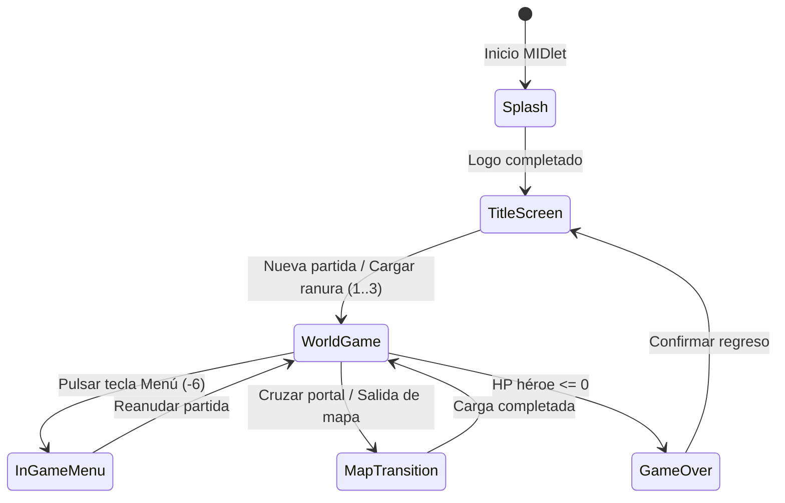

# Especificación del Motor: Bucle Principal, Ticks y Estados (T3.1)

**Documento:** `docs/spec/engine.md`  
**Clase desofuscada fuente:** `rpg/e.java`, `cm.java`, `de.java`, `bf.java`, `bc.java`  
**Estado:** Confirmado por ingeniería inversa  

---

## 1. Tasa de Lógica y Temporización (`TICK_HZ`)

El bucle del juego original implementa la interfaz `Runnable` en un hilo dedicado dentro de `rpg/e.java`.

### Presets de Velocidad y Selección Activa
El motor cuenta con un arreglo estático de 4 frecuencias de reloj para la lógica:
```java
private static final byte[] a = new byte[]{6, 10, 14, 18}; // Tasa en hercios (Hz)
public static byte b = 2;                                   // Índice activo por defecto (14 Hz)
```

- **Frecuencia nominal de juego (`TICK_HZ`):** **14 Hz** (~71.42 ms por tick de lógica).
- **Cálculo del sleep entre ticks:**
  $$\text{intervalo\_ms} = \left\lfloor \frac{1000}{\text{TICK\_HZ}} \right\rfloor = \left\lfloor \frac{1000}{14} \right\rfloor = 71 \text{ ms}$$
- **Modos secundarios de temporización:**
  - `a(10)`: Modo ralentizado / diálogos dramáticos (100 ms).
  - `a(20)`: Modo de transición / carga de pantalla (50 ms).

### Arquitectura de Bucle en Godot 4.7
Para garantizar la paridad exacta del comportamiento del juego sin sacrificar la suavidad visual en monitores de PC modernos (60 Hz, 144 Hz o superiores):
1. **Física / Lógica fija (`_physics_process(delta)`):** La simulación de estado, colisiones, timers de cooldown y acumuladores de movimiento se ejecuta desacoplada con el acumulador a 14 Hz o interpolada con tick fijo.
2. **Renderizado (`_process(delta)`):** El dibujo de sprites, la cámara cenital, los efectos de partículas y las interpolaciones visuales corren al framerate nativo del monitor (vsync / 60+ FPS).

---

## 2. Máquina de Estados Global del Juego

El juego utiliza una arquitectura de pantallas intercambiables basadas en la clase abstracta `bb.java` gestionada por `cm.a(bb pantalla)`:



### Tabla de Controladores de Estado

| Controlador | Nombre original | Función |
|---|---|---|
| `de` | `Canvas` nativo | Captura de eventos de teclado físico (`keyPressed`, `keyReleased`), pantalla completa y volcado del búfer gráfico. |
| `bc` | `TitleScreen` | Pantalla de título, selección de modo, créditos y selección de las 3 ranuras de guardado. |
| `bf` | `WorldScreen` | Pantalla principal de juego: actualiza el mundo, renderiza tiles, actores, enemigos, proyectiles, animaciones y dibuja el HUD. |
| `dq` | `GameState` | Estado persistente del jugador: inventario, equipamiento, ranuras de habilidad, dinero, banderas de misión y datos de mapa activo. |
| `e` | `MapManager` | Gestión de la cuadrícula de mapa actual, colisiones de capa, lista de entidades y tilesets cargados en memoria. |

---

## 3. Pseudocódigo del Bucle Principal Original

```python
def main_game_loop():
    tick_rate = 14  # Hz
    tick_interval_ms = 1000 // tick_rate  # 71 ms
    last_time = get_current_time_ms()
    is_running = True

    while is_running:
        now = get_current_time_ms()
        elapsed = now - last_time

        if elapsed < tick_interval_ms:
            sleep(tick_interval_ms - elapsed)
        else:
            yield_thread()

        last_time = get_current_time_ms()

        # 1. Procesar entrada acumulada
        process_input_events()

        # 2. Actualizar lógica de juego (si no está en pausa)
        if not is_paused():
            current_screen.update_logic(tick_interval_ms)
            audio_subsystem.update()

        # 3. Solicitar repintado gráfico
        request_screen_repaint()
```
