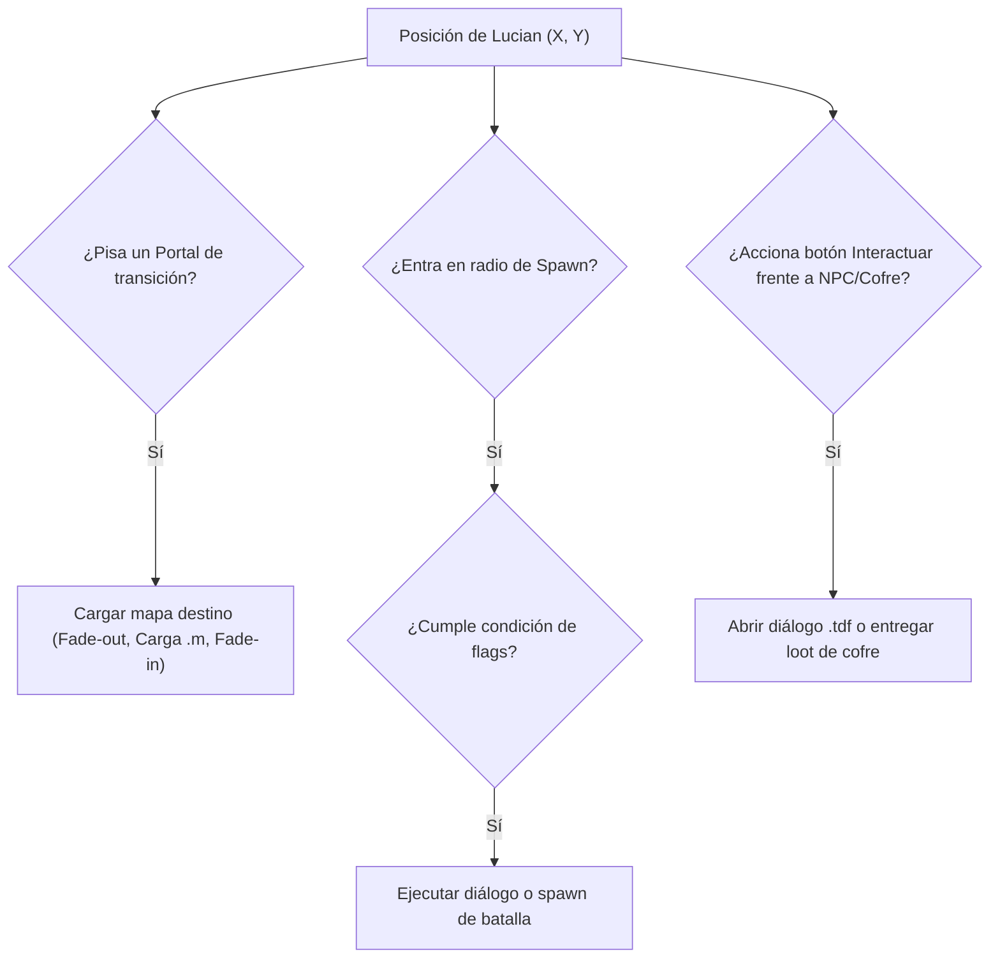

# Especificación de Eventos, Misiones y Guardado (T3.6)

**Documento:** `docs/spec/events_quests.md`  
**Clases desofuscadas fuente:** `dq.java`, `e.java`, `cx.java`, `rpg/d.java`, `docs/formats/tdf.md`, `docs/formats/map_m.md`  
**Estado:** Confirmado por ingeniería inversa  

---

## 1. Arquitectura de Banderas de Misión (Bitset de Eventos)

El motor original gestiona la progresión de la historia mediante un arreglo compacto de bytes donde cada bit individual actúa como un interruptor booleano (*flag*):

```java
// Manipulación de banderas en dq.java (líneas 399-430)
public static boolean get_flag(int id) {
    return ((N[id / 8] >> (id % 8)) & 1) == 1;
}

public static void set_flag(int id) {
    N[id / 8] = (byte)(N[id / 8] | (1 << (id % 8)));
}

public static void clear_flag(int id) {
    N[id / 8] = (byte)(N[id / 8] & ~(1 << (id % 8)));
}
```

### Banderas Críticas Confirmadas

| Flag ID | Efecto en el juego |
|:---:|---|
| **0..35** | Etapas principales de la campaña (vinculadas a los archivos de coordenadas `mmi/0` a `mmi/35`). |
| **50..120**| Misiones secundarias de gremios, favores a aldeanos y recompensas opcionales. |
| **200..230**| Apertura persistente de cofres únicos y puertas con llave de mazmorra. |
| **250** | **Bandera NG+ 1:** Desbloquea la clase secreta **Elemental** tras finalizar la historia por primera vez. |
| **251** | **Bandera NG+ 2:** Desbloquea la clase secreta **Gunblader** tras finalizar la historia por primera vez. |

---

## 2. Activadores de Mapa (Triggers y Portales)

El formato binario de mapas `.m` contiene 3 colecciones de activadores interactivos:



1. **Portales de mapa (`portals`):**
   - Registro de 4 bytes: `[origen_x, origen_y, destino_map_id, destino_x, destino_y]`.
   - Cuando el pie del personaje coincide con las casillas de entrada, se congela el input, se ejecuta un fundido a negro y se carga el mapa destino.
2. **Spawns de eventos (`spawns`):**
   - Zonas de paso invisible `[id, x, y]` que evalúan `get_flag(id)`. Si la bandera está apagada, disparan la cinemática o diálogo correspondiente y luego activan `set_flag(id)`.
3. **Objetos y NPCs (`objects`):**
   - Entidades con ID propio `[id, x, y]` que responden al botón de interacción frontal.

---

## 3. Sistema de Diálogos y Textos (`.tdf`)

Las 751 cadenas de texto en español extraídas en `out/text/` se presentan al jugador mediante la caja de diálogo:

- **Estructura visual:**
  - Panel inferior estilizado de $4$ líneas de texto legible.
  - Nombre del interlocutor en la cabecera superior izquierda.
  - Retrato ilustrado del personaje (Lucian, NPC o Jefe) a la izquierda de la caja.
  - Indicador animado de "Pulsar botón para continuar" (pequeña flecha o botón parpadeante).
- **Control de avance:**
  - Botón Acción / Confirmar avanza al siguiente bloque de texto.
  - Botón Cancelar acelera la escritura o completa el bloque de golpe.

---

## 4. Estructura de Guardado y Baúl Público Compartido

El juego original utilizaba el sistema RMS (*Record Management System*) de J2ME. Para la versión moderna de Godot en PC, se implementa mediante archivos en la ruta de usuario (`user://save_X.dat` y `user://shared_trunk.dat`):

### 4.1 Archivo de Partida (`user://save_X.dat` - Ranuras 1, 2 y 3)

```json
{
  "slot_id": 1,
  "hero_name": "Lucian",
  "class_id": 0,
  "level": 12,
  "playtime_seconds": 5420,
  "timestamp": "2026-10-14T22:00:00Z",
  "stats": {
    "hp_cur": 340,
    "hp_max": 340,
    "mp_cur": 72,
    "mp_max": 72,
    "gold": 1450,
    "exp_cur": 11200
  },
  "location": {
    "map_id": "m/m/00.m",
    "x": 224,
    "y": 320,
    "facing_direction": 2
  },
  "equipment": {
    "weapon": {"id": 1, "upgrade": 2},
    "shield": null,
    "armor": {"id": 10, "upgrade": 1},
    "accessory_1": {"id": 14, "upgrade": 0},
    "accessory_2": null
  },
  "inventory": [
    {"type": 18, "id": 1, "count": 5},
    {"type": 17, "id": 2, "count": 12}
  ],
  "shortcuts": [0, 1, -1, -1],
  "quick_item": {"type": 18, "id": 1},
  "flags_bitset": [127, 4, 0, 12, 0, 0, ...]
}
```

### 4.2 Almacenamiento Público Compartido (`user://shared_trunk.dat`)
Para satisfacer el requisito confirmado en la Fase 1 (`docs/reference/permitir-transferir-cosas-entre-partidas-guardadas.jpg`):
- Archivo independiente de las ranuras que persiste un baúl de inventario común accesible desde cualquier partida guardada activa.
- Permite depositar y retirar oro, gemas de refinación, consumibles y equipamiento para transferirlos entre diferentes clases o partidas de Lucian.
